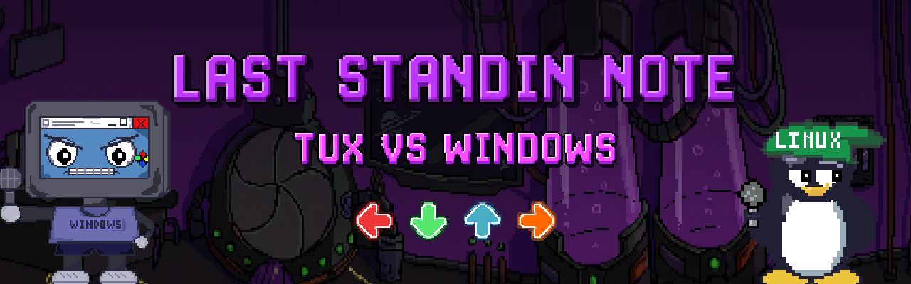
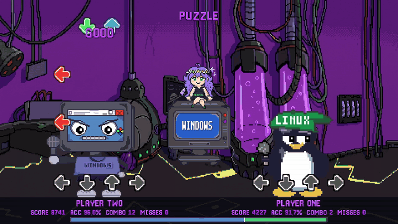
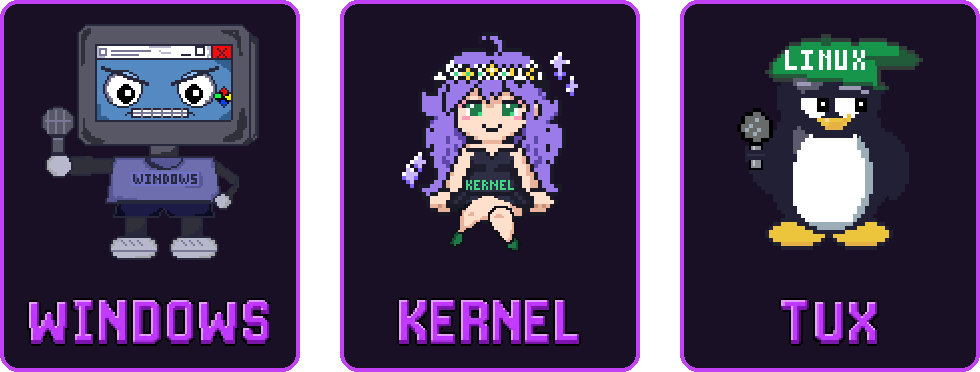
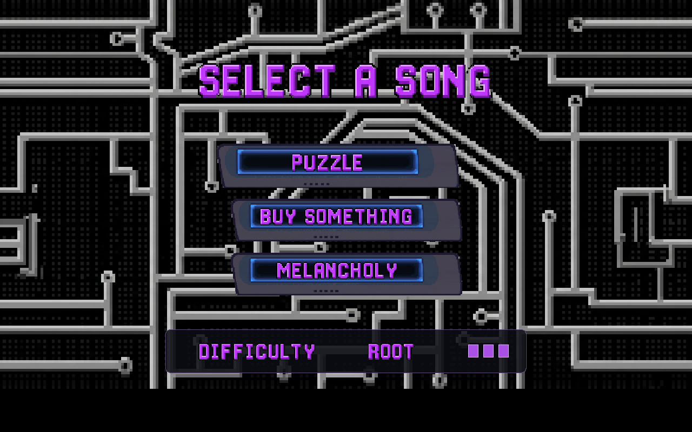
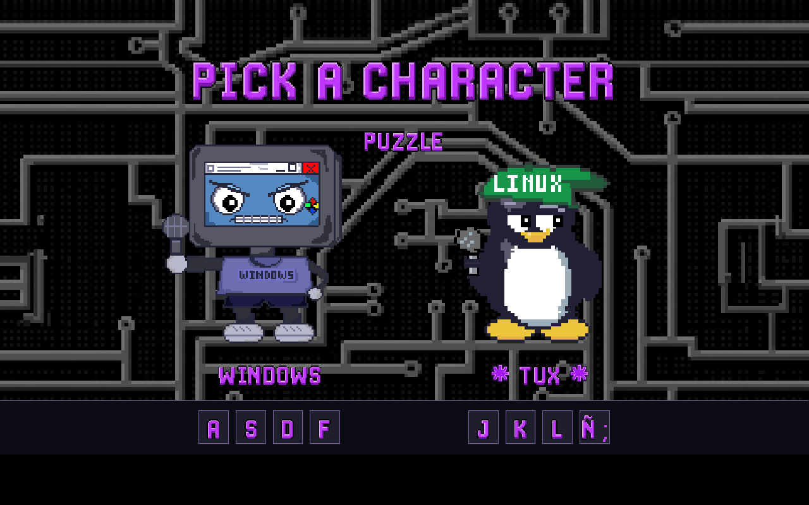
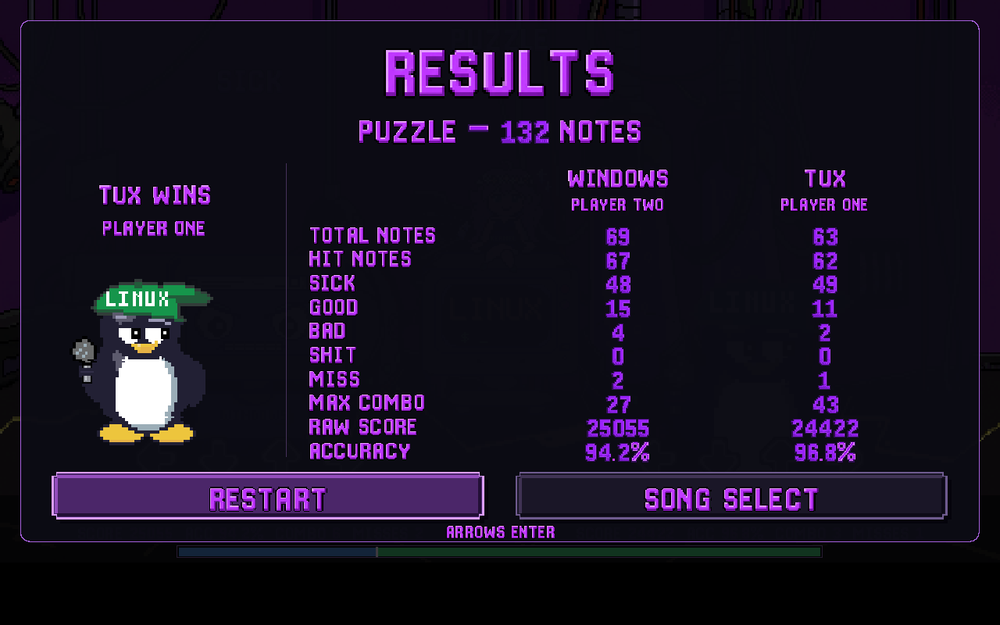
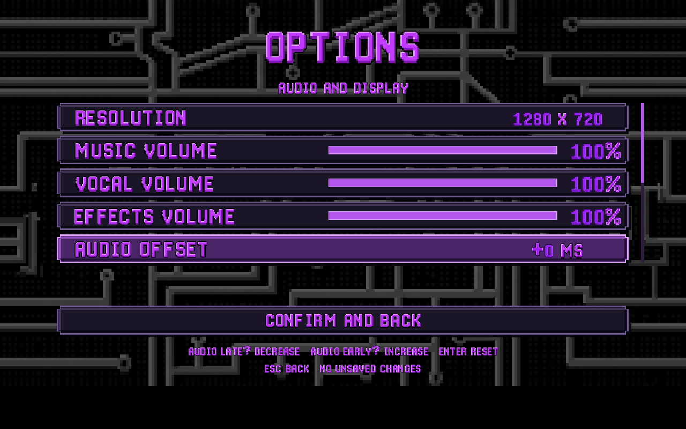

<div align="center">



<p><b>A pixel-art rhythm battle inspired by <i>Friday Night Funkin'</i>.</b><br>
Tux and Windows face off note by note while Kernel cheers from the monitor.</p>

[](https://github.com/MajaProjects/LastStandinNote/releases/latest)
[](https://github.com/MajaProjects/LastStandinNote/releases)
[](#-download-and-play)
[](#%EF%B8%8F-build-from-source)

<a href="https://github.com/MajaProjects/LastStandinNote/releases/latest">
  
</a>

<sub>Java is included in the download — nothing else to install.</sub>

<br><br>



</div>

## ✨ Features

<table>
  <tr>
    <td width="50%">🎵 <b>3 songs</b> with recorded character vocals that cut out when you miss</td>
    <td width="50%">💀 <b>3 difficulties</b> per song: <code>USER</code>, <code>ADMIN</code> and <code>ROOT</code></td>
  </tr>
  <tr>
    <td>🤖 <b>Single player</b> against an adaptive bot that pushes back when you're on a streak</td>
    <td>👥 <b>Two players</b> on one keyboard, with fair results for uneven charts</td>
  </tr>
  <tr>
    <td>🏆 <b>Local records</b> and rank badges, from <b>D</b> up to <b>P</b>erfect</td>
    <td>🎚️ <b>Audio offset</b> calibration, per-channel volume and FPS limit</td>
  </tr>
  <tr>
    <td>🌐 <b>English and Spanish</b>, picked automatically on first launch</td>
    <td>🎨 <b>Hand-drawn</b> sprites and bitmap lettering by the team</td>
  </tr>
</table>

## 🎭 Meet the cast

<p align="center">
  
</p>

<p align="center">
  <b>Windows</b> holds the left side · <b>Tux</b> holds the right · <b>Kernel</b> reacts to your combos from the monitor
</p>

## 📸 Screenshots

<table>
  <tr>
    <td></td>
    <td></td>
  </tr>
  <tr>
    <td align="center"><sub>Pick a song and difficulty</sub></td>
    <td align="center"><sub>Choose your side</sub></td>
  </tr>
  <tr>
    <td></td>
    <td></td>
  </tr>
  <tr>
    <td align="center"><sub>Compare results</sub></td>
    <td align="center"><sub>Tune audio and display</sub></td>
  </tr>
</table>

## 📥 Download and play

| | 🪟 Windows | 🐧 Linux |
| --- | --- | --- |
| **1. Download** | `LastStandinNote-…-Windows-x64.zip` | `LastStandinNote-…-Linux-x64.tar.gz` |
| **2. Extract** | Extract the whole ZIP | `tar xzf LastStandinNote-…-Linux-x64.tar.gz` |
| **3. Play** | Open `LastStandinNote.exe` | Run `./Start.sh` |

Both files are on the [**latest release**](https://github.com/MajaProjects/LastStandinNote/releases/latest) page. Keep every folder together after extracting — the game uses the Java runtime bundled beside it.

> [!TIP]
> If your hits feel late or early, open **Options → Audio offset**. Use a negative value if you hear the notes after you press, a positive one if before. Wireless headphones usually need a negative value.

## 🎮 Controls

| | Left | Down | Up | Right |
| --- | :---: | :---: | :---: | :---: |
| **Single player** | <kbd>D</kbd> | <kbd>F</kbd> | <kbd>J</kbd> | <kbd>K</kbd> |
| **Two players · Windows** | <kbd>A</kbd> | <kbd>S</kbd> | <kbd>D</kbd> | <kbd>F</kbd> |
| **Two players · Tux** | <kbd>J</kbd> | <kbd>K</kbd> | <kbd>L</kbd> | <kbd>Ñ</kbd> or <kbd>;</kbd> |

<kbd>↑</kbd> <kbd>↓</kbd> navigate · <kbd>←</kbd> <kbd>→</kbd> change difficulty, character or value · <kbd>Enter</kbd> confirm · <kbd>Esc</kbd> back · <kbd>P</kbd> pause · <kbd>F11</kbd> fullscreen

## 🕹️ How to play

Arrows scroll down to the receptors. **Tap** when an arrow reaches its receptor, and **hold** sustained notes until their tail ends. Hits push the shared health bar toward your side; misses push it back and mute your vocals.

<details>
<summary><b>📊 Judgements, accuracy and score</b></summary>
<br>

| Judgement | Timing window | Accuracy |
| --- | --- | :---: |
| 🟣 **SICK** | ≤ 45 ms | 100 % |
| 🔵 **GOOD** | ≤ 90 ms | 100 % |
| 🟡 **BAD** | ≤ 135 ms | 50 % |
| 🟠 **SHIT** | ≤ 160 ms | 25 % |
| 🔴 **MISS** | missed, or sustain released early | 0 % |

- **Score** rewards how close you are to the exact beat; **accuracy** uses the weights above.
- **BAD** and **MISS** break your combo. Combo milestones trigger an animation and a sound.
- In two-player mode, accuracy is relative to each side's notes and health influence is balanced, so a bigger chart is not an advantage. Ties are broken by points per note.

</details>

<details>
<summary><b>💀 Difficulties</b></summary>
<br>

| Difficulty | What changes |
| --- | --- |
| `USER` | Slower scrolling — a good place to start |
| `ADMIN` | Its own chart, an intermediate challenge |
| `ROOT` | Faster scrolling; notes sway and fade while the stage shakes. Notes settle near the receptor so the timing stays readable |

Change difficulty with <kbd>←</kbd> <kbd>→</kbd> on the song selection screen.

</details>

<details>
<summary><b>🏆 Records and ranks</b></summary>
<br>

Completed single-player runs save your **best score** and **best accuracy** for each song and difficulty, independently of each other. Bot and two-player runs never count.

| Rank | Accuracy |
| :---: | --- |
| **P** | exactly 100 % |
| **S** | above 95 % |
| **A** | 90 – 95 % |
| **B** | 80 – below 90 % |
| **C** | 70 – below 80 % |
| **D** | below 70 % |

</details>

<details>
<summary><b>⚙️ Options</b></summary>
<br>

| Option | Settings |
| --- | --- |
| Resolution | 960 × 540 · 1280 × 720 · 1920 × 1080 |
| Window mode | Windowed · Fullscreen |
| Volume | Music · Vocals · Effects |
| Audio offset | −200 to +200 ms in 5 ms steps (<kbd>Enter</kbd> resets it) |
| FPS limit | 30 · 60 · 120 · 244 · custom · unlimited |
| Show FPS / game stats | On · Off |
| Language | English · Español |

Changes apply when you choose **Confirm and back**; leaving with unsaved changes asks whether to save or discard them. The FPS limit only changes drawing — notes and vocals always follow the audio clock.

</details>

<details>
<summary><b>🐞 Something went wrong?</b></summary>
<br>

If the game hits an unexpected error, it shows a message and saves a log to `~/.laststandinnote/log.txt` inside your user folder. Please [open an issue](https://github.com/MajaProjects/LastStandinNote/issues) with that file, plus the song, difficulty, mode, character, operating system and steps to reproduce. The game version is shown on the title screen.

</details>

## 🛠️ Build from source

<details>
<summary><b>Run with your own JDK (17 or newer)</b></summary>
<br>

```bash
git clone https://github.com/MajaProjects/LastStandinNote.git
cd LastStandinNote
javac --release 17 -encoding UTF-8 -d out src/*.java

java -cp out:resources Main        # Linux / macOS
java -cp "out;resources" Main      # Windows
```

</details>

<details>
<summary><b>Create release packages</b></summary>
<br>

```bash
python tools/package_game.py
```

Builds a portable package with Java bundled, a source archive and checksums. It requires the exact JDK pinned for releases; see [**docs/PACKAGING.md**](docs/PACKAGING.md) for the full process and the Windows cross-build.

</details>

<details>
<summary><b>Project structure</b></summary>
<br>

```text
src/                 Screens, game rules, audio and settings
resources/images/    Characters, stages, arrows, UI, bitmap font and window icons
resources/audio/     Menu music and sound effects
resources/songs/     Instrumentals, vocals and USER/ADMIN/ROOT charts
packaging/           Native launcher icons
tools/               Validation and packaging tools
docs/                Maintainer documentation and README media
```

</details>

## 👥 Team

<table align="center">
  <tr>
    <td align="center" width="260">
      <b>Jacobo Parada Urriago</b><br>
      <sub>💻 Code · 🎵 Music</sub>
    </td>
    <td align="center" width="260">
      <b>Manuela Gutierrez Diaz</b><br>
      <sub>🎨 Sprites · ✍️ Lettering · 💻 Code</sub>
    </td>
  </tr>
</table>

<details>
<summary><b>🎼 Music credits</b></summary>
<br>

Character vocals were created by the team. Instrumentals keep their original authors and licenses:

| Song | Original instrumental | Author | License |
| --- | --- | --- | --- |
| Puzzle | [Puzzle Menu](https://opengameart.org/content/puzzle-menu) | caret7 | CC BY 4.0 |
| Buy Something | [Shop Theme](https://opengameart.org/content/shop-theme) | Cleyton Kauffman | CC0 1.0 |
| Melancholy | [Melancholy RPG](https://opengameart.org/content/melancholy-rpg) | Alexandr Zhelanov | CC BY 3.0 |

Every other external resource is credited on the in-game credits screen and in [CREDITS.txt](resources/CREDITS.txt).

</details>

## 📜 License

| What | License |
| --- | --- |
| Source code in `src/` | [GPL-3.0-only](LICENSE) |
| Team sprites, lettering, vocals, charts and icons | [CC BY-SA 4.0](LICENSE-ASSETS) |
| Third-party instrumentals, backgrounds, icons and sounds | Their own licenses — see [CREDITS.txt](resources/CREDITS.txt) |

Scope and copyright notices are in [NOTICE.md](NOTICE.md). The images in `docs/media/` are captures of the game; they include the backgrounds [Sci Fi Level](https://opengameart.org/content/sci-fi-level) by Jeremy Gooch and [Seamless Microscheme Texture](https://opengameart.org/content/seamless-microscheme-texture) by HorrorPen, both [CC BY 3.0](https://creativecommons.org/licenses/by/3.0/). *Friday Night Funkin'* belongs to The Funkin' Crew; this is an independent fan project.

<div align="center">
<br>

Mirror on [GitLab](https://gitlab.com/GLUD/gnubies/proyectos-2023-iii/2026-iii/gnubies-martes-8-10am/last-standin-note) · Made with ☕ and 🐧

</div>
